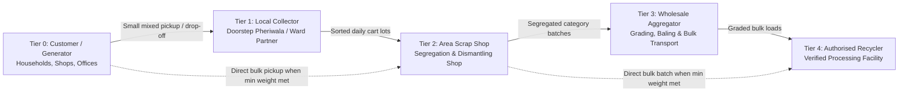
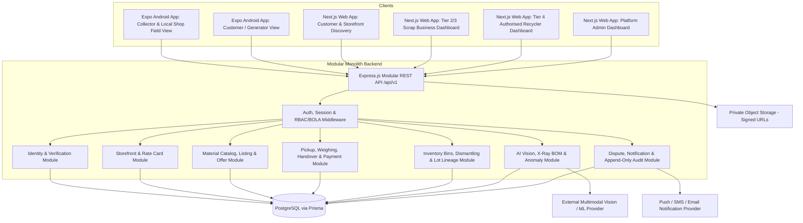

# Kabadiwala Connect — System Architecture, Multi-Tier Marketplace & Security Design

**Document Version:** 1.0 (Unified Master Blueprint — upgraded from v0.2)  
**Project Type:** Full-stack Multi-Tier Scrap & E-Waste Collection, Storefront Marketplace and Recycling Platform  
**Target Platforms:** Android Application (Field & Customer) and Web Application (Dashboards & Marketplace)  
**Primary Users:** Customers/Households, Local Collectors (*Pheriwalas*), Local Scrap Shops (*Dukaandars*), Wholesale Scrap Aggregators (*Mandis/Godowns*), Authorised Recyclers and Platform Administrators  
**Architecture Style:** Modular Monolith with Versioned REST API (`/api/v1`)  
**Database:** PostgreSQL  
**Backend:** Node.js, Express.js and TypeScript  
**Web Application:** Next.js (App Router + TypeScript)  
**Mobile Application:** React Native with Expo (TypeScript)  
**ORM & Validation:** Prisma ORM + Zod Shared Schemas  
**AI Integration:** Modular Vision & Intelligence Layer (Device X-Ray Component Valuation, Material & Purity Grading, Scale OCR Verification, Price Intelligence and Recycler Matching)

---

## 1. Project Overview

Kabadiwala Connect is a full-stack digital marketplace and supply-chain platform designed to connect households/material generators, local door-to-door collectors, neighborhood scrap shops, wholesale scrap aggregators and authorised recyclers through a transparent, rate-driven and traceable hierarchy.

### Why Both Food-Delivery UX and Multi-Tier Aggregation Matter

1. **Food-Delivery Style Discovery ("Storefronts & Rate Menus"):**  
   Just as restaurants publish menus, prices, ratings and delivery availability on food-delivery apps, every buying participant on Kabadiwala Connect publishes a **Digital Storefront** displaying accepted scrap categories, current purchase rates per unit (`kg` or `piece`), minimum pickup/drop-off thresholds, service area and verification status.
2. **Real-World Multi-Tier Scrap Hierarchy:**  
   Authorised industrial recyclers typically process sorted bulk loads (hundreds of kilograms to tons), whereas households and small offices dispose of 2–30 kg of mixed materials. Rather than fighting how India's recycling chain physically operates, Kabadiwala Connect digitises every tier so **dual-sided middle tiers can buy downward via their Storefront and sell aggregated sorted batches upward** to higher tiers:



*Note on Dynamic Eligibility:* Any seller at Tier $N$ may transact with any buyer at Tier $> N$ whenever their material listing meets that buyer's published **minimum quantity, accepted category, purity grade and service-area eligibility rules**.

### 1.1 Primary Objectives

- Provide a digital identity and profile system for collectors (`KC-COL-...`), scrap businesses (`KC-SHP-...`, `KC-WHL-...`) and recyclers (`KC-REC-...`).
- Support multi-level identity, business and recycler verification with clear, honest verification statuses.
- Enable buying tiers to operate **Storefronts with transparent published Rate Cards** while letting sellers browse, compare offers and request doorstep pickup or shop drop-off.
- Track upward **Inventory Batching & Lot Lineage** as small collected lots are sorted, dismantled and aggregated into wholesale batches for authorised recyclers.
- Use **Enhanced Camera & Multimodal AI** to identify materials, decompose devices/appliances into recoverable internal components ("X-Ray Valuation"), assist purity grading and verify scale readings—always under human confirmation.
- Distinguish strictly between **Indicative AI Estimates**, **Published Storefront Rates / Offers**, **Agreed Prices** and **Final Settlements**.
- Track collection, weighing, handover, receipts and payment records (including first-class Cash, UPI and Ledger settlements).
- Support unreliable field internet connectivity through controlled, idempotent offline synchronization.
- Protect personal information, business documents and transaction records from initial design.
- Maintain honest chain-of-custody traceability **without falsely claiming that a platform receipt or badge is a government ID or statutory EPR certificate**.

### 1.2 Design Principles

1. **Security by design:** Security controls (authentication, RBAC, BOLA/BFLA protection, input validation, rate limiting, audit trails) are built into Phase 1 architecture, never bolted on later.
2. **Role-based and object-level access:** Every request verifies identity, active status, role capability, object ownership/participation and valid state transition on the server.
3. **Verification before trust:** An account, a verified phone number, a reviewed identity, a verified scrap business and a CPCB/SPCB registered recycler are distinct statuses and are never conflated.
4. **Transparent, honest pricing:** Indicative estimates, storefront rate-card offers, agreed prices and final weighed settlements are stored separately with explicit timestamps and adjustment reasons.
5. **Human oversight over AI:** AI outputs carry confidence scores and uncertainty warnings; AI never silently alters agreed prices, approves verifications or executes punitive actions without human workflow.
6. **Privacy by default:** Collect only data needed for clear operational purposes; strip unnecessary PII/metadata before third-party processing; restrict exact residential addresses to authorised active pickups.
7. **Immutable traceability:** Critical verification, pricing, weighing, handover and batch-aggregation events are recorded in append-only audit logs.
8. **Modular implementation:** A clean TypeScript monorepo allows solo-developer speed today while keeping clean boundaries for future service extraction.

---

## 2. System Architecture & Monorepo Structure

Kabadiwala Connect uses a **Modular Monolith Backend (`Node.js + Express + TypeScript + Prisma`)** backed by **PostgreSQL**, serving both the **Next.js Web Application** and the **React Native (Expo) Mobile Application**, sharing strict schemas through an internal shared package.

### 2.1 High-Level System Architecture



### 2.2 Recommended Monorepo Workspace Layout

```text
kabadi/
├── apps/
│   ├── api/                    # Node.js + Express.js + TypeScript REST API (/api/v1)
│   │   ├── prisma/             # schema.prisma, migrations, seed scripts
│   │   └── src/
│   │       ├── config/         # Validated env config, CORS, rate limiters
│   │       ├── middleware/     # Auth, RBAC, BOLA ownership guards, Zod validator, error handler
│   │       ├── modules/
│   │       │   ├── auth/
│   │       │   ├── users/
│   │       │   ├── verification/
│   │       │   ├── materials/
│   │       │   ├── storefronts/    # Zomato-style shop profiles & rate menus
│   │       │   ├── listings/       # Seller lots & multi-offer bidding
│   │       │   ├── transactions/   # Pickups, orders, weighing, handovers, receipts
│   │       │   ├── inventory/      # Tier 1-3 stock bins, dismantling & batch lineage
│   │       │   ├── payments/       # Cash, UPI reference & ledger settlements
│   │       │   ├── disputes/
│   │       │   ├── ai/             # Device X-Ray BOM, classification, scale OCR check, matching
│   │       │   ├── admin/
│   │       │   └── audit/          # Append-only security & business event logger
│   │       └── server.ts
│   ├── web/                    # Next.js Web App (Customer, Scrap Business, Recycler, Admin)
│   └── mobile/                 # React Native (Expo) Android App (Customer, Collector, Field Weighing)
├── packages/
│   └── shared/                 # Shared Zod validation schemas, DTO types, enums, constants
├── docs/
│   └── ARCHITECTURE.md
└── package.json                # npm / pnpm workspaces root
```

---

## 3. User Roles, Hierarchy Tiers and Dashboards

Each account has a **Role** enforcing access permissions, and business/collector accounts additionally carry a **Supply-Chain Tier** governing marketplace discovery and aggregation workflows:

| Account Role | Supply-Chain Tier | Typical Real-World Actor | Platform ID Prefix |
|---|---|---|---|
| `CUSTOMER` | `TIER_0_GENERATOR` | Households, retail shops, offices, schools, repair shops | `KC-CUS-XXXXXX` |
| `COLLECTOR` | `TIER_1_LOCAL_COLLECTOR` | Individual door-to-door *kabadiwala* / ward collector | `KC-COL-XXXXXX` |
| `SCRAP_BUSINESS` | `TIER_2_AREA_SHOP` | Local scrap shop (*dukaandar*) buying from customers & collectors, sorting & dismantling | `KC-SHP-XXXXXX` |
| `SCRAP_BUSINESS` | `TIER_3_WHOLESALE_AGGREGATOR` | City/regional *mandi* or baling godown aggregating sorted category loads | `KC-WHL-XXXXXX` |
| `AUTHORISED_RECYCLER` | `TIER_4_AUTHORISED_RECYCLER` | Verified recycling plant / smelter / processor with checked official authorisation | `KC-REC-XXXXXX` |
| `ADMIN` | `PLATFORM_STAFF` | Authorised platform operations, verification & security staff | Internal only |

### 3.1 Customer / Generator Dashboard (`TIER_0`)
- Create minimal profile (privacy-preserving; exact address revealed only after pickup acceptance).
- Scan electronics/appliances/scrap piles with **Camera AI** to inspect recoverable components and view indicative value ranges before selling.
- Browse nearby verified **Tier 1 / Tier 2 Storefronts** (rates, accepted materials, ratings, pickup minimums) or post a listing to receive offers.
- Schedule pickup or generate a drop-off request, confirm live scale weights, view final settlement, download receipts and raise disputes.

### 3.2 Collector / Local Kabadiwala Dashboard (`TIER_1`)
- Manage digital profile, verification status and platform-issued ID card (`KC-COL-...` with public-safe QR verification link).
- Operate a **Local Buyer Storefront**: publish neighborhood buying rates per category, toggle `OPEN / OFFLINE` availability, accept nearby customer pickups and record collection/weighing events.
- Aggregate daily collected scrap into **Collector Stock**, compare published buying rates of nearby **Tier 2 Area Shops & Tier 3 Aggregators**, and book upward sales for higher margins.
- Track daily cash/UPI settlements, receipts and earnings ledger.

### 3.3 Scrap Business / Aggregator Dashboard (`TIER_2` & `TIER_3`)
- **Dual-Sided Operations ("Buy Downward + Sell Upward"):**
  - *Downward Storefront:* Publish live rate menus (pickup rate vs. shop drop-off gate rate), minimum weight rules, business hours and accepted categories for Customers (`Tier 0`), Collectors (`Tier 1`) or smaller Shops (`Tier 2`).
  - *Shop Inventory & Dismantling:* Automatically add purchased weights into category bins; log **Appliance/Device Dismantling** (e.g., splitting a collected AC or batch of computers into copper, aluminum, motor, plastic and graded PCBs); merge child lots into traceable bulk batches for sale to `Tier 3` or `Tier 4`.
- Submit business registration documents and track verification status / expiry.
- **Strict Boundary:** A `SCRAP_BUSINESS` account **never** automatically receives `AUTHORISED_RECYCLER` status or regulated hazardous-processing permissions.

### 3.4 Authorised Recycler Dashboard (`TIER_4`)
- Maintain verified official registration details (e.g., CPCB/SPCB registration numbers, permitted waste streams, authorized capacity and validity dates).
- Publish wholesale purchase rate cards and quality grade specifications visible to eligible aggregators, shops and bulk generators.
- Receive bulk lot handovers with complete upstream **Lot Lineage**, record plant gate weighing, material inspection and processing completion milestones.

### 3.5 Admin Dashboard (`ADMIN`)
- Review identity, business and recycler verification submissions against evidence and official portals; approve, reject, request info or suspend with mandatory reason logging.
- Manage master material catalog, device reference BOM catalog, hazard guidance and platform rules.
- Investigate transaction disputes, AI anomaly alerts, scale discrepancy flags and append-only audit logs.

### 3.6 Role and Permission Matrix

| Capability | Customer (`T0`) | Collector (`T1`) | Scrap Business (`T2`/`T3`) | Authorised Recycler (`T4`) | Admin |
|---|---|---|---|---|---|
| Manage own profile | Yes | Yes | Yes | Yes | Own staff profile |
| Publish Storefront & buying rate card | No | Yes (local scope) | Yes (tier-permitted) | Yes (permitted streams) | Moderate / suspend |
| Create sell listings / upward batches | Yes | Yes | Yes | As permitted | Moderate |
| Use Camera AI scan & X-Ray estimate | Yes | Yes | Yes | Yes | Audit / monitor |
| Manage own transactions & confirm weight | Yes | Yes | Yes | Yes | Investigate only |
| Record dismantling / batch aggregation | No | Basic sorting | Yes | Processing milestones | Audit |
| Submit verification evidence | Optional | Yes | Yes | Mandatory | Review |
| Approve / change verification level | No | No | No | No | Authorised staff only |
| Change own role or self-elevate to Admin | No | No | No | No | No self-elevation |
| View another user's private KYC files | No | No | No | No | Restricted + logged |
| Direct edit of completed transactions | No | No | No | No | Controlled adjustment event only |

---

## 4. Digital Identity and Verification System

### 4.1 Honest Verification Levels (Internal Platform Statuses)
Platform verification levels establish operational trust **without claiming government authority**:

- **Level 0 — `REGISTERED`:** Account created; basic onboarding complete.
- **Level 1 — `CONTACT_VERIFIED`:** Mobile OTP / email ownership verified.
- **Level 2 — `IDENTITY_REVIEWED`:** Submitted identity check reviewed by authorized staff; raw identity numbers remain strictly private and never appear on public profiles.
- **Level 3 — `BUSINESS_VERIFIED`:** Applicable shop/trade/GST/municipal evidence reviewed for the business's operating tier and jurisdiction (recognising that small collectors and informal shops may have different legal registration thresholds than wholesale companies).
- **Level 4 — `AUTHORISED_RECYCLER_VERIFIED`:** Official authorisation checked against the relevant statutory source (such as the official CPCB E-Waste EPR Portal: https://eprewaste.cpcb.gov.in/) with recorded reference number, permitted categories, validity window, evidence snapshot and reviewing administrator.

### 4.2 Verification Lifecycle & Platform ID Rules
- Verification statuses: `NOT_SUBMITTED`, `PENDING`, `UNDER_REVIEW`, `ACTION_REQUIRED`, `VERIFIED`, `REJECTED`, `EXPIRED`, `SUSPENDED`.
- Status transitions are server-only and emit an immutable `VerificationAuditEvent`.
- Platform ID cards (`KC-COL-000123`, `KC-SHP-000045`) include a public QR link displaying **only public-safe fields** (display name, platform ID, current verification badge, active status, issue/review dates) and carry an explicit disclaimer: *"Platform-issued Kabadiwala Connect ID — not a government identity or statutory licence."*

---

## 5. Storefronts, Material Catalog and Honest Pricing Engine

### 5.1 Database-Driven Material & Regulated Stream Catalog
- Categories cover general recyclables (*Paper/Cardboard, Plastics, Ferrous Metals, Non-Ferrous Metals, Glass*) alongside regulated streams (*E-Waste/IT, White-Goods Appliances, Batteries*) — each carrying explicit unit rules (`KG`, `PIECE`), purity grades (`GRADE_A`, `GRADE_B`, `CLEAN`, `MIXED`), safety guidance and buyer verification requirements (for example, routing regulated hazardous streams strictly toward appropriately verified buyers).

### 5.2 Four Strictly Distinct Price States
To prevent user confusion and price bait-and-switch, every price on the platform is typed explicitly:

1. **`INDICATIVE_ESTIMATE`:** Calculated from user-entered or AI-identified items/components against recent verified storefront offers. Clearly badged as an *indicative estimate, subject to physical inspection and weighing*.
2. **`STOREFRONT_RATE_OR_OFFER`:** Versioned rate published on a buyer's storefront rate card (with timestamp, min weight, pickup vs. drop-off condition and grade) or a specific offer on a listing. Accepting locks that `offerVersionId`.
3. **`AGREED_PRICE`:** Mutually accepted rate/amount prior to handover. Cannot be silently overwritten by either party.
4. **`FINAL_SETTLEMENT`:** Computed from verified `actualWeight` (stored separately from `estimatedWeight`) plus any mutually confirmed, reason-coded grade/contamination adjustment (`WEIGHT_DIFFERENCE`, `GRADE_DOWNGRADE`, `GRADE_UPGRADE`, `MOISTURE_CONTAMINATION`, `PARTIAL_ACCEPTANCE`).

All monetary amounts use exact integer minor units (`paise`, `BigInt`/`Int`) or fixed `DECIMAL(12, 2)` — never binary floating point.

---

## 6. Collection, Weighing, Batch Lineage and Transaction Lifecycle

### 6.1 State Machine

`DRAFT → LISTED / STOREFRONT_REQUESTED → ACCEPTED → PICKUP_SCHEDULED → COLLECTED → WEIGHED → HANDED_OVER → SETTLED → COMPLETED`

Exception states: `CANCELLED`, `REJECTED`, `ON_HOLD`, `DISPUTED`.

Every transition is validated on the server by participant role, ownership and required evidence (for example, `WEIGHED` requires recorded actual item weights and scale evidence; `SETTLED` requires a recorded `PaymentRecord`).

### 6.2 Multi-Tier Lot Aggregation & Chain of Custody
When a `TIER_1` Collector or `TIER_2` Shop sells aggregated material upward to `TIER_2`, `TIER_3` or `TIER_4`:
- Purchased items increment the buyer's category `InventoryBin`.
- Optional `DismantlingRecord` logs splitting whole units (e.g., old PCs, ACs, phones) into constituent material bins (`PCB Grade A`, `Copper`, `Aluminum`, `Battery`, `Steel`) plus declared non-recyclable residue.
- Upward bulk listings link via `BatchLineage` to the contributing child transactions—creating auditable origin-to-recycler traceability while explicitly labeling receipts according to actual verified milestones (never claiming recycling completion until confirmed by a verified `TIER_4` facility).

---

## 7. Enhanced Camera Vision & AI Architecture

AI assists users and reviewers across high-friction moments **while strictly respecting human oversight, privacy minimisation and pricing honesty**.

### 7.1 Six Modular AI Services (`apps/api/src/modules/ai`)

1. **Device & Appliance "X-Ray" Component Scanner (High-Value Electronics & Appliances):**
   - When scanning a **mobile phone, laptop, tablet, router, TV or AC/appliance**, multi-angle photos (front, back/model label, ports/condition) identify the probable category/model and map it against `DeviceReferenceBOM` records to show recoverable internal value drivers (e.g., *high-density telecom PCB, camera module, display state, Li-ion pack, aluminum frame*, or *Copper vs. Aluminum AC condenser coil*).
   - Displays multi-pathway **Indicative Estimate Ranges** (*Repair/Refurbish vs. Parts Harvest vs. Scrap Material Value*) with explicit confidence scores and model version metadata.
2. **Material & Purity Grade Classifier:**
   - Suggests material category and purity grade (e.g., distinguishing high-IC `Grade A` circuit boards from low-density power boards, or estimating copper recovery ratio in insulated cables without open-air burning).
   - Low-confidence results (`confidence < threshold`) require manual user selection before proceeding.
3. **Whole-Pile Multi-Item Detection:**
   - Detects multiple visible scrap categories in mixed household/shop photos to pre-fill draft listing items for user confirmation.
4. **Weighing & Handover Evidence Verification Check:**
   - Performs OCR on scale display photographs to compare visible scale digits against manually entered `actualWeight`, checks perceptual image hashes (`pHash`) to flag reused duplicate photos, and flags implausible weight-to-category entries for human confirmation or admin review.
5. **Data-Backed Price Intelligence:**
   - Computes regional rate ranges and trends solely from real, timestamped storefront offers and verified completed transactions—clearly distinguished from live binding offers.
6. **Eligible Buyer & Recycler Matching + Anomaly Flagging:**
   - Hard-filters buyers by **verification level, accepted regulated categories, minimum weight and service area first**, then ranks eligible storefronts by effective payout, proximity and fulfilment reliability.
   - Flags repeated last-minute price drops, abnormal weight discrepancies, circular wash-trading patterns or unverified hazardous-stream claims as **review signals** (with full appeal/dispute support).

### 7.2 Mandatory AI Guardrails & Privacy Controls
- Strip EXIF GPS coordinates and never send KYC documents, phone numbers or exact residential addresses to external AI APIs.
- Validate all external AI outputs through strict server-side `Zod` schemas with timeouts and graceful fallback to manual entry if the AI service is unreachable.
- Never allow AI output to bypass RBAC, auto-verify accounts or silently modify an agreed transaction price.

---

## 8. Database Architecture (PostgreSQL + Prisma)

### 8.1 Core Domain Entities

- **Identity, RBAC & Sessions:** `User`, `UserProfile`, `Organization` (stores `tier`, `platformCode`, `storefrontActive`), `RefreshToken`, `LoginAttempt`
- **Verification & Compliance:** `VerificationCase`, `VerificationDocument`, `BusinessRegistration`, `RecyclerRegistration`, `VerificationDecision`
- **Catalog, X-Ray BOM & Storefronts:** `MaterialCategory`, `DeviceReferenceBOM`, `Storefront`, `StorefrontRateItem` (versioned rates, pickup/dropoff rules, min weights), `PriceHistory`
- **Listings, Offers & Multi-Tier Transactions:** `MaterialListing`, `ListingItem`, `ListingPhoto`, `PurchaseOffer`, `TransactionOrder`, `OrderItem`, `WeighingRecord`, `HandoverRecord`, `PaymentRecord`, `Dispute`
- **Inventory & Traceability:** `InventoryBin`, `DismantlingRecord`, `BatchLineage`
- **AI, Offline Sync & Integrity:** `AIScanRecord`, `AnomalyFlag`, `SyncOperation` (idempotency keys), `Notification`, `AuditEvent`

### 8.2 Key Integrity Rules
- Foreign keys, check constraints (`weight >= 0`, `amount_paise >= 0`), unique platform codes (`KC-...`) and unique `(actorId, idempotencyKey)` on `SyncOperation`.
- Append-only semantics for `AuditEvent`, `VerificationDecision` and `PurchaseOffer` history.

---

## 9. Security Architecture & Threat Controls (OWASP API Security Aligned)

1. **Authentication:** Argon2id password hashing; hashed short-TTL OTPs with strict attempt caps; short-lived signed JWT access tokens + rotating revocable `RefreshToken` (`HttpOnly, Secure, SameSite` cookies on Next.js web; `expo-secure-store` on React Native mobile); MFA enforcement path for `ADMIN`.
2. **Authorization (RBAC + BOLA + Mass-Assignment Defense):**
   - Server middleware verifies authentication → account active state → role capability → explicit resource ownership/participation check on every ID lookup → strict Zod allowlist DTOs blocking client submission of `role`, `verificationStatus`, `platformCode`, `agreedAmountPaise`, etc.
3. **Rate Limiting & Abuse Protection:** Tiered limiters on `/auth/*`, `/ai/*`, `/upload/*`, `/listings` and `/offers`.
4. **Secure File Handling:** Magic-byte file validation (not client MIME header alone), strict size caps, random server-generated object keys, private storage buckets, short-lived signed URLs and audit logging whenever sensitive KYC documents are viewed by admins.
5. **Secrets, Backups & Incident Response:** Environment-validated secrets (never committed or exposed in `NEXT_PUBLIC_*` / client bundles), encrypted automated PostgreSQL backups with periodic restore drills, and documented session-revocation / key-rotation runbooks.

---

## 10. Offline-First Mobile Sync & Versioned API (`/api/v1`)

### 10.1 Controlled Offline Capabilities (Expo Android App)
- Cache user profile, platform ID QR card, material catalog, hazard guides, recent rate cards and synced ledger history locally; store tokens exclusively in `expo-secure-store`.
- Queue offline listing drafts, captured photos, collection notes and provisional field weighing captures as `SyncOperation` items carrying `(operationId, clientEntityId, opType, createdAt, payload)` revalidated idempotently by the server upon reconnection.

### 10.2 Core `/api/v1` Endpoint Groups
`/auth`, `/users`, `/verification`, `/materials`, `/storefronts`, `/listings`, `/offers`, `/pickups`, `/orders`, `/weighing`, `/inventory`, `/payments`, `/disputes`, `/ai`, `/notifications`, `/admin` — all returning consistent typed envelopes without internal stack traces.

---

## 11. Staged Implementation Roadmap

- **Phase 1 — Foundation, Monorepo & Security Core:** Workspace setup (`apps/api`, `apps/web`, `apps/mobile`, `packages/shared`), Prisma schema & migrations, Argon2id + JWT/refresh auth, RBAC/BOLA middleware, rate limiting, Zod validation, append-only `AuditEvent` and security integration tests.
- **Phase 2 — Storefronts, Catalog & Multi-Tier Marketplace:** Database material catalog, Storefront & live Rate Card management (`Tier 1–4`), Customer/Collector listing flow, offer versioning & acceptance, and separate role dashboards in Next.js.
- **Phase 3 — Verification, Weighing, Inventory Lineage & Settlements:** Level 0–4 admin verification workflows, `KC-...` platform IDs + public verification page, actual scale weighing, Cash/UPI/Ledger payment records, receipts, disputes, shop `InventoryBin`, dismantling logs and `BatchLineage` upward sales.
- **Phase 4 — Enhanced Camera AI & X-Ray Valuation:** Device X-Ray component BOM scanner, material/purity classifier, scale OCR cross-check, `pHash` duplicate detection, confidence confirmation UI and data-backed buyer ranking.
- **Phase 5 — Field-Ready Expo Mobile App & Offline Sync:** React Native Android workflows for Collectors & Customers, camera capture, spoken vernacular rate readouts (`EN / HI / PA / MR`), idempotent `SyncOperation` queue and low-bandwidth optimisation.
- **Phase 6 — Production Hardening & Pilot:** CI pipeline, backup/restore verification, OWASP API security test suite, monitoring and controlled local pilot rollout.
